# Awesome Claude Video Styles 

[English](README.md) · [中文](README.zh.md)

**103 种视频风格**，用 Claude（或任何会写代码的 agent）就能做——发布片、讲解、片头、梗、歌词视频——每种都有样片和可以直接复制的长提示词。按它像谁起名：Linear 式发布片、Kurzgesagt 式科普、星球大战式开场字幕、Windows XP 报错梗。

点任意一个风格看样片和提示词。把提示词连同你自己的内容贴进 Claude Code（或 Codex、Cursor……）就行；想要渲染和配乐工具可以先 `npx skills add sunsiyuan/ultramotion`。全部风格：**[ultramotion.ai/templates](https://ultramotion.ai/templates/?lang=zh&utm_source=github&utm_medium=readme&utm_campaign=awesome-claude-video-styles)**。

## 目录

- [3D](#3d) (6)
- [AI 电影感](#ai-cinematic) (3)
- [产品和品牌](#product-brand) (17)
- [数据和新闻](#data-news) (13)
- [片头和开场](#titles-intros) (9)
- [游戏和梗](#games-memes) (4)
- [讲解](#explainers) (18)
- [歌词和音乐](#lyrics-music) (7)
- [招牌和海报](#signs-posters) (7)
- [会动的画](#art-in-motion) (6)
- [祝福和纪念](#greetings-moments) (8)
- [更多](#more) (5)

## 3D

动画短片、游戏级场景、科学模拟和产品拆解，都是代码搭的。

<table>
<tr><td valign="top" width="33%"><a href="https://ultramotion.ai/templates/apple-style-product-teardown/?lang=zh&utm_source=github&utm_medium=readme&utm_campaign=awesome-claude-video-styles">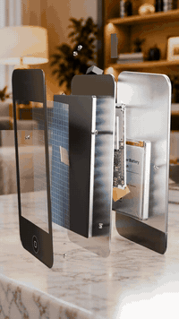</a> <a href="https://ultramotion.ai/templates/apple-style-product-teardown/?lang=zh&utm_source=github&utm_medium=readme&utm_campaign=awesome-claude-video-styles"><b>【3D】苹果式产品拆解</b></a> 产品一层层炸开、悬停给你看里面，再合上——像苹果发布会的拆解镜头</td><td valign="top" width="33%"><a href="https://ultramotion.ai/templates/game-cinematic-3d-world/?lang=zh&utm_source=github&utm_medium=readme&utm_campaign=awesome-claude-video-styles">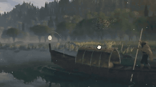</a> <a href="https://ultramotion.ai/templates/game-cinematic-3d-world/?lang=zh&utm_source=github&utm_medium=readme&utm_campaign=awesome-claude-video-styles"><b>【3D】游戏级实时场景</b></a> 一片水、一条船、一座山谷，像 3A 游戏过场那样在浏览器里实时渲染 样片作者 @MengTo</td><td valign="top" width="33%"> <a href="https://ultramotion.ai/templates/pixar-style-3d-short/?lang=zh&utm_source=github&utm_medium=readme&utm_campaign=awesome-claude-video-styles"><b>【3D】皮克斯风小短片</b></a> 几个卡通角色、一个笑点，像动画电影那样打光和剪辑 样片作者 @somasoma_blue</td></tr>
<tr><td valign="top" width="33%"><a href="https://ultramotion.ai/templates/interstellar-black-hole/?lang=zh&utm_source=github&utm_medium=readme&utm_campaign=awesome-claude-video-styles">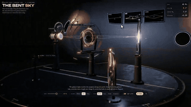</a> <a href="https://ultramotion.ai/templates/interstellar-black-hole/?lang=zh&utm_source=github&utm_medium=readme&utm_campaign=awesome-claude-video-styles"><b>【3D】星际穿越式科学模拟</b></a> 黑洞、粒子对撞机这类看不见的东西，按真实物理做成电影感的 3D 片 样片作者 @Voxyz_ai</td><td valign="top" width="33%"><a href="https://ultramotion.ai/templates/voxel-diorama/?lang=zh&utm_source=github&utm_medium=readme&utm_campaign=awesome-claude-video-styles">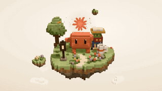</a> <a href="https://ultramotion.ai/templates/voxel-diorama/?lang=zh&utm_source=github&utm_medium=readme&utm_campaign=awesome-claude-video-styles"><b>【3D】体素小岛（我的世界风）</b></a> 一块漂浮的体素小岛，方块搭出的小房子、树和小角色，慢慢转 样片作者 @blueemi99</td><td valign="top" width="33%"><a href="https://ultramotion.ai/templates/90s-demoscene/?lang=zh&utm_source=github&utm_medium=readme&utm_campaign=awesome-claude-video-styles">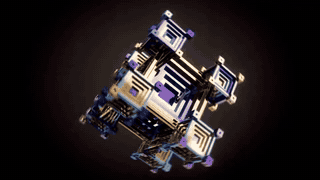</a> <a href="https://ultramotion.ai/templates/90s-demoscene/?lang=zh&utm_source=github&utm_medium=readme&utm_campaign=awesome-claude-video-styles"><b>【3D】90 年代 Demoscene</b></a> 一个 html 文件、零素材，跟着音乐切换一段段程序生成的特效 样片作者 @JustinPerea</td></tr>
</table>

## AI 电影感

用视频生成模型做的真人和梦境画面：把名画演成电影，不可能的地方。

<table>
<tr><td valign="top" width="33%"> <a href="https://ultramotion.ai/templates/masterpiece-movie-scene/?lang=zh&utm_source=github&utm_medium=readme&utm_campaign=awesome-claude-video-styles"><b>【名画电影】剧场版</b></a> 把名画背后那一刻演成一场真人电影，最后定格成原画 样片作者 Da哒哒哒</td><td valign="top" width="33%"><a href="https://ultramotion.ai/templates/fly-into-the-painting/?lang=zh&utm_source=github&utm_medium=readme&utm_campaign=awesome-claude-video-styles">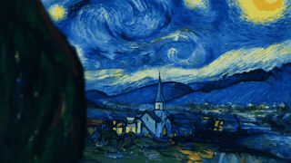</a> <a href="https://ultramotion.ai/templates/fly-into-the-painting/?lang=zh&utm_source=github&utm_medium=readme&utm_campaign=awesome-claude-video-styles"><b>【名画电影】飞进画里</b></a> 一个镜头飞过画里的世界，最后停在整幅原画上 样片作者 故文愿.</td><td valign="top" width="33%"><a href="https://ultramotion.ai/templates/dreamcore-giant-creatures/?lang=zh&utm_source=github&utm_medium=readme&utm_campaign=awesome-claude-video-styles">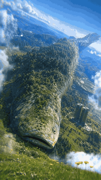</a> <a href="https://ultramotion.ai/templates/dreamcore-giant-creatures/?lang=zh&utm_source=github&utm_medium=readme&utm_campaign=awesome-claude-video-styles"><b>【梦核】巨物</b></a> 晴天草地上漂着长满树的巨鱼，广角仰拍，像一个你好像去过的梦 样片作者 茗Debussy</td></tr>
</table>

## 产品和品牌

新品发布、logo、App 功能。

<table>
<tr><td valign="top" width="33%"><a href="https://ultramotion.ai/templates/manus-style-launch-video/?lang=zh&utm_source=github&utm_medium=readme&utm_campaign=awesome-claude-video-styles">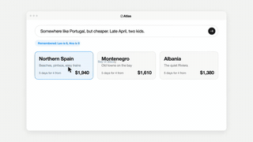</a> <a href="https://ultramotion.ai/templates/manus-style-launch-video/?lang=zh&utm_source=github&utm_medium=readme&utm_campaign=awesome-claude-video-styles"><b>【Manus 式】发布片</b></a> 发布会式的产品片：瓷白底、字从模糊里浮出、New ___ 章节、真实界面加光标、风景上的玻璃卡片、One More Thing</td><td valign="top" width="33%"> <a href="https://ultramotion.ai/templates/linear-style-launch-video/?lang=zh&utm_source=github&utm_medium=readme&utm_campaign=awesome-claude-video-styles"><b>【Linear 式】发布片</b></a> 暗、静、精确的产品片：界面平放在黑暗里，镜头贴着斜滑过去、景深很浅，需求一个键一个键打出来，回答一行行到达，最后黑底一行白字</td><td valign="top" width="33%"><a href="https://ultramotion.ai/templates/claude-code-style-terminal-launch/?lang=zh&utm_source=github&utm_medium=readme&utm_campaign=awesome-claude-video-styles">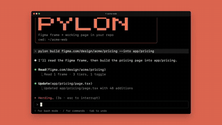</a> <a href="https://ultramotion.ai/templates/claude-code-style-terminal-launch/?lang=zh&utm_source=github&utm_medium=readme&utm_campaign=awesome-claude-video-styles"><b>【Claude Code 式】终端发布片</b></a> 开发者工具的发布片：赤陶色底上的黑终端，一条命令打出来，代理一步步带着绿色 diff 跑完，结果在旁边窗口里搭起来，四个终端一起打勾，最后是安装命令</td></tr>
<tr><td valign="top" width="33%"><a href="https://ultramotion.ai/templates/liquid-glass-logo-reveal/?lang=zh&utm_source=github&utm_medium=readme&utm_campaign=awesome-claude-video-styles">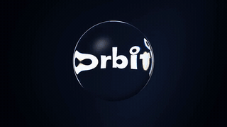</a> <a href="https://ultramotion.ai/templates/liquid-glass-logo-reveal/?lang=zh&utm_source=github&utm_medium=readme&utm_campaign=awesome-claude-video-styles"><b>【苹果液态玻璃】Logo 揭晓</b></a> 一条 logo 片头：深色玻璃滑过海军蓝，折成水珠滚到 logo 上把它折弯，再破开留下清楚的 logo，最后白底上变成磨砂玻璃</td><td valign="top" width="33%"><a href="https://ultramotion.ai/templates/apple-style-software-launch/?lang=zh&utm_source=github&utm_medium=readme&utm_campaign=awesome-claude-video-styles">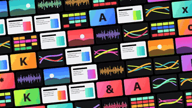</a> <a href="https://ultramotion.ai/templates/apple-style-software-launch/?lang=zh&utm_source=github&utm_medium=readme&utm_campaign=awesome-claude-video-styles"><b>【苹果式】软件发布片</b></a> 纯黑底、一拍一句的软件发布片：每个动词由它自己的字演出来，作品在笔记本、平板、手机之间跳，最后价格、彩色 App 名和 logo</td><td valign="top" width="33%"> <a href="https://ultramotion.ai/templates/stripe-style-gradient-launch/?lang=zh&utm_source=github&utm_medium=readme&utm_campaign=awesome-claude-video-styles"><b>【Stripe 式】渐变发布片</b></a> 明亮精确的产品片：斜着的流动渐变带、藏青大标题、带长柔影的界面卡片层层浮着、数字往上跳、带光弧的地球</td></tr>
<tr><td valign="top" width="33%"><a href="https://ultramotion.ai/templates/arc-browser-style-launch/?lang=zh&utm_source=github&utm_medium=readme&utm_campaign=awesome-claude-video-styles">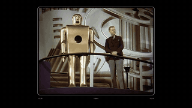</a> <a href="https://ultramotion.ai/templates/arc-browser-style-launch/?lang=zh&utm_source=github&utm_medium=readme&utm_campaign=awesome-claude-video-styles"><b>【Arc 浏览器式】发布片</b></a> 俏皮的发布片：一串公有领域老影像里的「第一次尝试」装在老电视框里，黑底上柔和衬线字，马卡龙色的产品画面，电光蓝结尾卡</td><td valign="top" width="33%"><a href="https://ultramotion.ai/templates/nothing-style-product-reveal/?lang=zh&utm_source=github&utm_medium=readme&utm_campaign=awesome-claude-video-styles">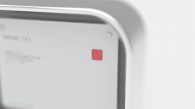</a> <a href="https://ultramotion.ai/templates/nothing-style-product-reveal/?lang=zh&utm_source=github&utm_medium=readme&utm_campaign=awesome-claude-video-styles"><b>【Nothing 式】产品揭晓</b></a> 硬件发布片：米白虚空里的棚拍渲染一秒一切，透明背壳和会画图的点阵灯，小小的打字机字幕，黑底上零件飞散，几个配色排成一排</td><td valign="top" width="33%"> <a href="https://ultramotion.ai/templates/ai-app-before-after-ad/?lang=zh&utm_source=github&utm_medium=readme&utm_campaign=awesome-claude-video-styles"><b>【AI 应用】前后对比广告</b></a> TikTok 上 AI 应用投得最多的格式：钩子横幅、照片扫成 AI 结果、你的照片 ⊕ 风格、分屏、商店结尾卡；换文案就是一条新变体</td></tr>
<tr><td valign="top" width="33%"><a href="https://ultramotion.ai/templates/app-feature/?lang=zh&utm_source=github&utm_medium=readme&utm_campaign=awesome-claude-video-styles">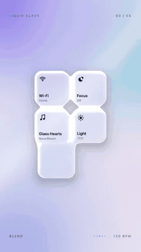</a> <a href="https://ultramotion.ai/templates/app-feature/?lang=zh&utm_source=github&utm_medium=readme&utm_campaign=awesome-claude-video-styles"><b>【苹果液态玻璃】App 新功能</b></a> 功能上线、版本更新、产品介绍</td><td valign="top" width="33%"><a href="https://ultramotion.ai/templates/product-demo/?lang=zh&utm_source=github&utm_medium=readme&utm_campaign=awesome-claude-video-styles">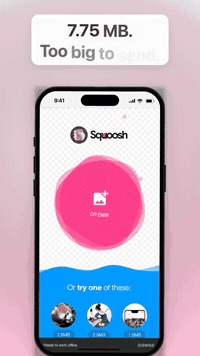</a> <a href="https://ultramotion.ai/templates/product-demo/?lang=zh&utm_source=github&utm_medium=readme&utm_campaign=awesome-claude-video-styles"><b>【真实界面】产品演示</b></a> 新功能上线、产品发布、App 测评：真界面在手机或浏览器里被用起来</td><td valign="top" width="33%"> <a href="https://ultramotion.ai/templates/ink-logo-reveal/?lang=zh&utm_source=github&utm_medium=readme&utm_campaign=awesome-claude-video-styles"><b>【墨水入水】片头 Logo</b></a> 公司、品牌、影片的片头 logo</td></tr>
<tr><td valign="top" width="33%"><a href="https://ultramotion.ai/templates/product-reveal/?lang=zh&utm_source=github&utm_medium=readme&utm_campaign=awesome-claude-video-styles">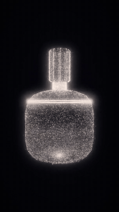</a> <a href="https://ultramotion.ai/templates/product-reveal/?lang=zh&utm_source=github&utm_medium=readme&utm_campaign=awesome-claude-video-styles"><b>【粒子光效】产品和 Logo 揭晓</b></a> 新品发布、logo 揭晓、品牌片头</td><td valign="top" width="33%"><a href="https://ultramotion.ai/templates/milk-pour-loop/?lang=zh&utm_source=github&utm_medium=readme&utm_campaign=awesome-claude-video-styles">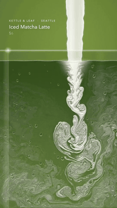</a> <a href="https://ultramotion.ai/templates/milk-pour-loop/?lang=zh&utm_source=github&utm_medium=readme&utm_campaign=awesome-claude-video-styles"><b>【奶倒进咖啡】新品循环屏</b></a> 咖啡店、茶饮店的新品和菜单屏</td><td valign="top" width="33%"><a href="https://ultramotion.ai/templates/glitch-streetwear-drop/?lang=zh&utm_source=github&utm_medium=readme&utm_campaign=awesome-claude-video-styles">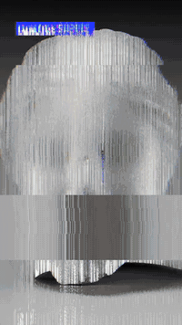</a> <a href="https://ultramotion.ai/templates/glitch-streetwear-drop/?lang=zh&utm_source=github&utm_medium=readme&utm_campaign=awesome-claude-video-styles"><b>【故障风】潮牌发售</b></a> 潮牌、球鞋、新品发售预告</td></tr>
<tr><td valign="top" width="33%"><a href="https://ultramotion.ai/templates/city-model-reveal/?lang=zh&utm_source=github&utm_medium=readme&utm_campaign=awesome-claude-video-styles">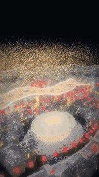</a> <a href="https://ultramotion.ai/templates/city-model-reveal/?lang=zh&utm_source=github&utm_medium=readme&utm_campaign=awesome-claude-video-styles"><b>【粒子光效】城市模型亮灯</b></a> 楼盘、园区、城市规划发布</td><td valign="top" width="33%"><a href="https://ultramotion.ai/templates/glitch-security-launch/?lang=zh&utm_source=github&utm_medium=readme&utm_campaign=awesome-claude-video-styles">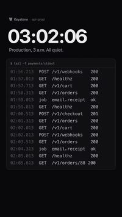</a> <a href="https://ultramotion.ai/templates/glitch-security-launch/?lang=zh&utm_source=github&utm_medium=readme&utm_campaign=awesome-claude-video-styles"><b>【故障风】产品发布</b></a> 安全、监控类产品发布</td></tr>
</table>

## 数据和新闻

排名、地图和图表，把发生的事讲清楚。

<table>
<tr><td valign="top" width="33%"><a href="https://ultramotion.ai/templates/tweet-to-video/?lang=zh&utm_source=github&utm_medium=readme&utm_campaign=awesome-claude-video-styles">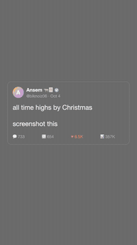</a> <a href="https://ultramotion.ai/templates/tweet-to-video/?lang=zh&utm_source=github&utm_medium=readme&utm_campaign=awesome-claude-video-styles"><b>【帖子】一条帖子讲成视频</b></a> 大 V 的喊单、回复区、官方公告：帖子当钩子，数据讲清楚</td><td valign="top" width="33%"> <a href="https://ultramotion.ai/templates/cnn-style-breaking-news/?lang=zh&utm_source=github&utm_medium=readme&utm_campaign=awesome-claude-video-styles"><b>【CNN 式】突发新闻</b></a> 红色 3D「BREAKING NEWS」甩进来，切到你的画面配下三分之一字幕、LIVE 角标和滚动新闻条——一本正经播一条不是新闻的新闻</td><td valign="top" width="33%"> <a href="https://ultramotion.ai/templates/collage-news-explainer/?lang=zh&utm_source=github&utm_medium=readme&utm_campaign=awesome-claude-video-styles"><b>【Vox 剪报】一周新闻讲清楚</b></a> 这周的判决、政策、纪录，用原件、剪报和红线讲清楚</td></tr>
<tr><td valign="top" width="33%"><a href="https://ultramotion.ai/templates/bar-chart-race/?lang=zh&utm_source=github&utm_medium=readme&utm_campaign=awesome-claude-video-styles">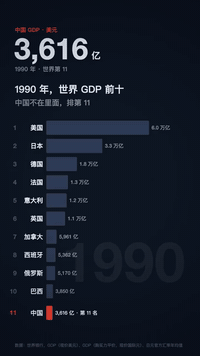</a> <a href="https://ultramotion.ai/templates/bar-chart-race/?lang=zh&utm_source=github&utm_medium=readme&utm_campaign=awesome-claude-video-styles"><b>【数据动画】排名赛跑</b></a> GDP、城市、品牌排名几十年怎么变</td><td valign="top" width="33%"><a href="https://ultramotion.ai/templates/election-night-map/?lang=zh&utm_source=github&utm_medium=readme&utm_campaign=awesome-claude-video-styles">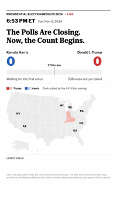</a> <a href="https://ultramotion.ai/templates/election-night-map/?lang=zh&utm_source=github&utm_medium=readme&utm_campaign=awesome-claude-video-styles"><b>【CNN 魔墙】开票之夜</b></a> 选举开票、各地结果一个个出来</td><td valign="top" width="33%"><a href="https://ultramotion.ai/templates/if-you-bought/?lang=zh&utm_source=github&utm_medium=readme&utm_campaign=awesome-claude-video-styles">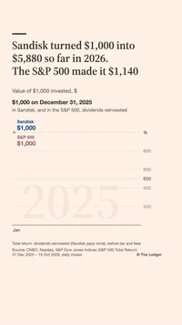</a> <a href="https://ultramotion.ai/templates/if-you-bought/?lang=zh&utm_source=github&utm_medium=readme&utm_campaign=awesome-claude-video-styles"><b>【数据动画】当年买了现在值多少</b></a> 一只股票或基金十年的回报</td></tr>
<tr><td valign="top" width="33%"><a href="https://ultramotion.ai/templates/disaster-on-the-map/?lang=zh&utm_source=github&utm_medium=readme&utm_campaign=awesome-claude-video-styles">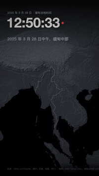</a> <a href="https://ultramotion.ai/templates/disaster-on-the-map/?lang=zh&utm_source=github&utm_medium=readme&utm_campaign=awesome-claude-video-styles"><b>【3D 地图】灾害展开</b></a> 地震、台风、山火在地图上怎么展开</td><td valign="top" width="33%"><a href="https://ultramotion.ai/templates/mix-over-time/?lang=zh&utm_source=github&utm_medium=readme&utm_campaign=awesome-claude-video-styles">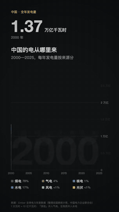</a> <a href="https://ultramotion.ai/templates/mix-over-time/?lang=zh&utm_source=github&utm_medium=readme&utm_campaign=awesome-claude-video-styles"><b>【数据动画】构成怎么变</b></a> 能源结构、收入构成、市场份额怎么变</td><td valign="top" width="33%"><a href="https://ultramotion.ai/templates/where-the-money-goes/?lang=zh&utm_source=github&utm_medium=readme&utm_campaign=awesome-claude-video-styles">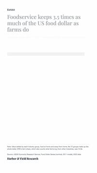</a> <a href="https://ultramotion.ai/templates/where-the-money-goes/?lang=zh&utm_source=github&utm_medium=readme&utm_campaign=awesome-claude-video-styles"><b>【信息图】一块钱去了哪</b></a> 收入、预算、开销按用途拆开</td></tr>
<tr><td valign="top" width="33%"><a href="https://ultramotion.ai/templates/road-to-the-title/?lang=zh&utm_source=github&utm_medium=readme&utm_campaign=awesome-claude-video-styles">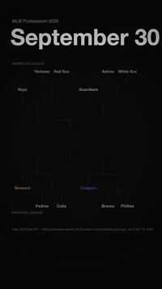</a> <a href="https://ultramotion.ai/templates/road-to-the-title/?lang=zh&utm_source=github&utm_medium=readme&utm_campaign=awesome-claude-video-styles"><b>【事件回放】一路晋级</b></a> 季后赛、杯赛，一支队伍一路打到决赛</td><td valign="top" width="33%"> <a href="https://ultramotion.ai/templates/if-it-were-100/?lang=zh&utm_source=github&utm_medium=readme&utm_campaign=awesome-claude-video-styles"><b>【如果世界是 100 人】信息图</b></a> 人口、销量按比例缩成 100 个来讲</td><td valign="top" width="33%"><a href="https://ultramotion.ai/templates/number-over-the-years/?lang=zh&utm_source=github&utm_medium=readme&utm_campaign=awesome-claude-video-styles">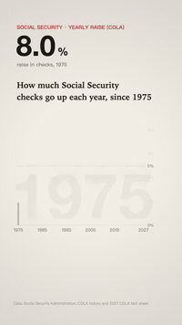</a> <a href="https://ultramotion.ai/templates/number-over-the-years/?lang=zh&utm_source=github&utm_medium=readme&utm_campaign=awesome-claude-video-styles"><b>【数据动画】历年一个数字</b></a> 出生人口、房价，一个数几十年的变化</td></tr>
<tr><td valign="top" width="33%"><a href="https://ultramotion.ai/templates/market-crash-night/?lang=zh&utm_source=github&utm_medium=readme&utm_campaign=awesome-claude-video-styles">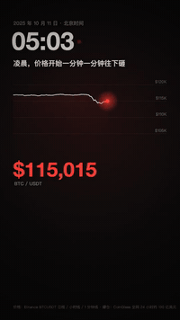</a> <a href="https://ultramotion.ai/templates/market-crash-night/?lang=zh&utm_source=github&utm_medium=readme&utm_campaign=awesome-claude-video-styles"><b>【事件回放】一夜行情</b></a> 暴跌、爆仓、一夜行情复盘</td></tr>
</table>

## 片头和开场

电影、节目、直播的开场。

<table>
<tr><td valign="top" width="33%"> <a href="https://ultramotion.ai/templates/film-opening-credits/?lang=zh&utm_source=github&utm_medium=readme&utm_campaign=awesome-claude-video-styles"><b>【A24 片头】电影开场字幕</b></a> 纪录片、短片、家庭影像的片头</td><td valign="top" width="33%"><a href="https://ultramotion.ai/templates/star-wars-style-opening-crawl/?lang=zh&utm_source=github&utm_medium=readme&utm_campaign=awesome-claude-video-styles">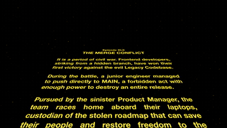</a> <a href="https://ultramotion.ai/templates/star-wars-style-opening-crawl/?lang=zh&utm_source=github&utm_medium=readme&utm_campaign=awesome-claude-video-styles"><b>【星球大战式】开场滚动字幕</b></a> 黑底蓝字「很久很久以前」，标题缩进太空，黄色段落沿透视滚远，最后摇到行星——给团队、生日、毕业写一段史诗</td><td valign="top" width="33%"><a href="https://ultramotion.ai/templates/stranger-things-style-title/?lang=zh&utm_source=github&utm_medium=readme&utm_campaign=awesome-claude-video-styles">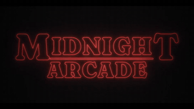</a> <a href="https://ultramotion.ai/templates/stranger-things-style-title/?lang=zh&utm_source=github&utm_medium=readme&utm_campaign=awesome-claude-video-styles"><b>【怪奇物语式】片头</b></a> 红色描边字在黑暗里发光，从极近特写滑到一起拼出片名，配 80 年代模拟合成器——给节目、播客、游戏开场</td></tr>
<tr><td valign="top" width="33%"><a href="https://ultramotion.ai/templates/show-opener/?lang=zh&utm_source=github&utm_medium=readme&utm_campaign=awesome-claude-video-styles">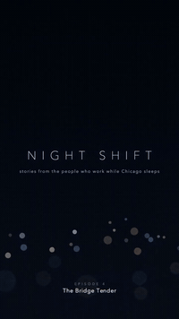</a> <a href="https://ultramotion.ai/templates/show-opener/?lang=zh&utm_source=github&utm_medium=readme&utm_campaign=awesome-claude-video-styles"><b>【电影感】节目片头</b></a> 播客、栏目、频道的片头</td><td valign="top" width="33%"> <a href="https://ultramotion.ai/templates/glitch-drama-title/?lang=zh&utm_source=github&utm_medium=readme&utm_campaign=awesome-claude-video-styles"><b>【故障风】短剧片名</b></a> 短剧、悬疑剧、一集的片名</td><td valign="top" width="33%"><a href="https://ultramotion.ai/templates/glitch-podcast-intro/?lang=zh&utm_source=github&utm_medium=readme&utm_campaign=awesome-claude-video-styles">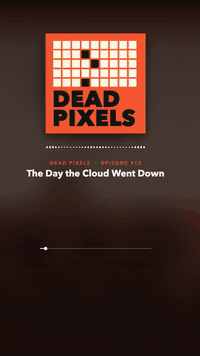</a> <a href="https://ultramotion.ai/templates/glitch-podcast-intro/?lang=zh&utm_source=github&utm_medium=readme&utm_campaign=awesome-claude-video-styles"><b>【故障风】播客开场</b></a> 科技播客、节目冷开场</td></tr>
<tr><td valign="top" width="33%"><a href="https://ultramotion.ai/templates/paper-storybook-intro/?lang=zh&utm_source=github&utm_medium=readme&utm_campaign=awesome-claude-video-styles">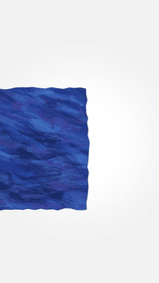</a> <a href="https://ultramotion.ai/templates/paper-storybook-intro/?lang=zh&utm_source=github&utm_medium=readme&utm_campaign=awesome-claude-video-styles"><b>【纸雕绘本】故事开场</b></a> 睡前故事播客、儿童故事频道的片头</td><td valign="top" width="33%"><a href="https://ultramotion.ai/templates/paper-saul-bass-titles/?lang=zh&utm_source=github&utm_medium=readme&utm_campaign=awesome-claude-video-styles">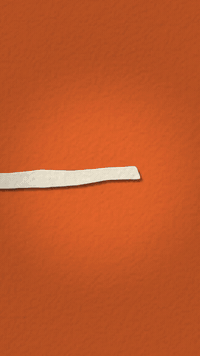</a> <a href="https://ultramotion.ai/templates/paper-saul-bass-titles/?lang=zh&utm_source=github&utm_medium=readme&utm_campaign=awesome-claude-video-styles"><b>【索尔·巴斯】剪纸片头</b></a> 话剧、电影、展览的预告片头</td><td valign="top" width="33%"><a href="https://ultramotion.ai/templates/pixel-stream-starting/?lang=zh&utm_source=github&utm_medium=readme&utm_campaign=awesome-claude-video-styles">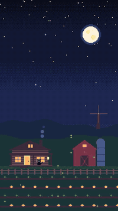</a> <a href="https://ultramotion.ai/templates/pixel-stream-starting/?lang=zh&utm_source=github&utm_medium=readme&utm_campaign=awesome-claude-video-styles"><b>【像素风】Twitch 直播开场</b></a> 游戏直播开播前的等待画面、开场倒计时</td></tr>
</table>

## 游戏和梗

街机对战、老游戏机、老桌面，还有不是新闻的突发新闻。

<table>
<tr><td valign="top" width="33%"><a href="https://ultramotion.ai/templates/street-fighter-style-vs-screen/?lang=zh&utm_source=github&utm_medium=readme&utm_campaign=awesome-claude-video-styles">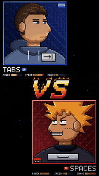</a> <a href="https://ultramotion.ai/templates/street-fighter-style-vs-screen/?lang=zh&utm_source=github&utm_medium=readme&utm_campaign=awesome-claude-video-styles"><b>【街霸式】对战画面</b></a> 90 年代街机对峙：两张像素头像砸进来，着火的 VS 砸在中间，属性条、ROUND 1、FIGHT!——给任何该一决高下的两样东西</td><td valign="top" width="33%"><a href="https://ultramotion.ai/templates/windows-xp-style-error-meme/?lang=zh&utm_source=github&utm_medium=readme&utm_campaign=awesome-claude-video-styles">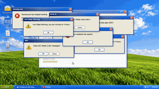</a> <a href="https://ultramotion.ai/templates/windows-xp-style-error-meme/?lang=zh&utm_source=github&utm_medium=readme&utm_campaign=awesome-claude-video-styles"><b>【Windows XP 式】报错梗</b></a> 绿山蓝天的 XP 桌面，关于你生活的报错弹窗越弹越多、拖出残影，最后蓝屏</td><td valign="top" width="33%"><a href="https://ultramotion.ai/templates/game-boy-style-mini-adventure/?lang=zh&utm_source=github&utm_medium=readme&utm_campaign=awesome-claude-video-styles">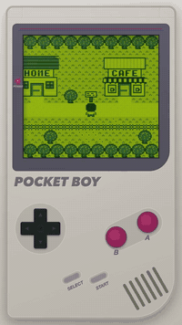</a> <a href="https://ultramotion.ai/templates/game-boy-style-mini-adventure/?lang=zh&utm_source=github&utm_medium=readme&utm_campaign=awesome-claude-video-styles"><b>【Game Boy 式】迷你冒险</b></a> 初代 Game Boy 撑满竖屏，四阶绿屏开机，你的角色在小镇里走、对话、拿道具、升一级——把你的一天做成一个小游戏</td></tr>
<tr><td valign="top" width="33%"><a href="https://ultramotion.ai/templates/pixel-tournament-trailer/?lang=zh&utm_source=github&utm_medium=readme&utm_campaign=awesome-claude-video-styles">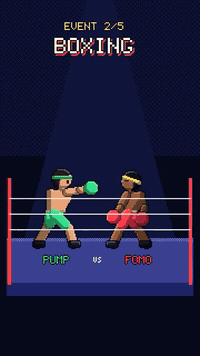</a> <a href="https://ultramotion.ai/templates/pixel-tournament-trailer/?lang=zh&utm_source=github&utm_medium=readme&utm_campaign=awesome-claude-video-styles"><b>【像素风】比赛预告</b></a> 运动会、联赛、游戏之夜：几个项目一个个登场</td></tr>
</table>

## 讲解

一个道理，写在黑板上、做成扁平动画，或者配在口播上。

<table>
<tr><td valign="top" width="33%"><a href="https://ultramotion.ai/templates/3blue1brown-style-math-explainer/?lang=zh&utm_source=github&utm_medium=readme&utm_campaign=awesome-claude-video-styles">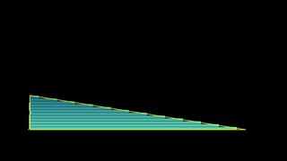</a> <a href="https://ultramotion.ai/templates/3blue1brown-style-math-explainer/?lang=zh&utm_source=github&utm_medium=readme&utm_campaign=awesome-claude-video-styles"><b>【3Blue1Brown 式】数学讲解</b></a> 把一个数学道理演出来：黑底 Manim 动画、Computer Modern 公式一笔笔写出、先盯一个再看全部，配旁白</td><td valign="top" width="33%"><a href="https://ultramotion.ai/templates/kurzgesagt-style-yellowstone/?lang=zh&utm_source=github&utm_medium=readme&utm_campaign=awesome-claude-video-styles">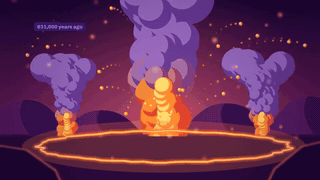</a> <a href="https://ultramotion.ai/templates/kurzgesagt-style-yellowstone/?lang=zh&utm_source=github&utm_medium=readme&utm_campaign=awesome-claude-video-styles"><b>【Kurzgesagt 风】黄石超级火山喷发会怎样</b></a> 一个"如果明天发生"的灾难推演：地下岩浆房、前兆、喷发、按比例的体积、火山碎屑流、火山灰地图、全球降温、概率，最后回到黄石的清晨</td><td valign="top" width="33%"><a href="https://ultramotion.ai/templates/kurzgesagt-style-human-origins/?lang=zh&utm_source=github&utm_medium=readme&utm_campaign=awesome-claude-video-styles">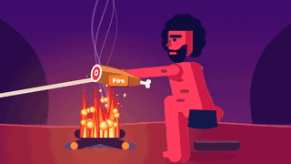</a> <a href="https://ultramotion.ai/templates/kurzgesagt-style-human-origins/?lang=zh&utm_source=github&utm_medium=readme&utm_campaign=awesome-claude-video-styles"><b>【Kurzgesagt 风】人类从哪来</b></a> 一段很长的历史压进一分多钟：直立行走、石器、火、走出非洲、冰河、农耕，最后落在一条时间线上</td></tr>
<tr><td valign="top" width="33%"><a href="https://ultramotion.ai/templates/kurzgesagt-style-black-hole/?lang=zh&utm_source=github&utm_medium=readme&utm_campaign=awesome-claude-video-styles">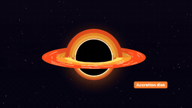</a> <a href="https://ultramotion.ai/templates/kurzgesagt-style-black-hole/?lang=zh&utm_source=github&utm_medium=readme&utm_campaign=awesome-claude-video-styles"><b>【Kurzgesagt 风】黑洞的一生</b></a> 一个东西从生到死讲一遍：恒星的平衡、聚变到铁、超新星、黑洞诞生、吸积盘，最后蒸发</td><td valign="top" width="33%"><a href="https://ultramotion.ai/templates/kurzgesagt-style-army-ant-raid/?lang=zh&utm_source=github&utm_medium=readme&utm_campaign=awesome-claude-video-styles">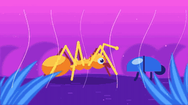</a> <a href="https://ultramotion.ai/templates/kurzgesagt-style-army-ant-raid/?lang=zh&utm_source=github&utm_medium=readme&utm_campaign=awesome-claude-video-styles"><b>【Kurzgesagt 风】行军蚁的突袭</b></a> 讲一大群东西怎么协作：活的巢、蚂蚁桥、兵蚁和工蚁，几十万只像一个动物一样行军</td><td valign="top" width="33%"><a href="https://ultramotion.ai/templates/kurzgesagt-style-deep-sea-dive/?lang=zh&utm_source=github&utm_medium=readme&utm_campaign=awesome-claude-video-styles">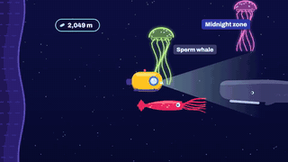</a> <a href="https://ultramotion.ai/templates/kurzgesagt-style-deep-sea-dive/?lang=zh&utm_source=github&utm_medium=readme&utm_campaign=awesome-claude-video-styles"><b>【Kurzgesagt 风】潜到海底</b></a> 一个镜头一路往下：从珊瑚礁到发光的深海，到泰坦尼克、热泉，最后落到一万米的海沟底</td></tr>
<tr><td valign="top" width="33%"><a href="https://ultramotion.ai/templates/kurzgesagt-style-dinosaur-extinction/?lang=zh&utm_source=github&utm_medium=readme&utm_campaign=awesome-claude-video-styles">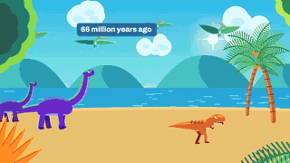</a> <a href="https://ultramotion.ai/templates/kurzgesagt-style-dinosaur-extinction/?lang=zh&utm_source=github&utm_medium=readme&utm_campaign=awesome-claude-video-styles"><b>【Kurzgesagt 风】恐龙灭绝的那一天</b></a> 一个历史大事件从头到尾演一遍：小行星、撞击、海啸、大火、长夜，再到活下来的鸟和我们的祖先</td><td valign="top" width="33%"><a href="https://ultramotion.ai/templates/kurzgesagt-style-life-after-people/?lang=zh&utm_source=github&utm_medium=readme&utm_campaign=awesome-claude-video-styles">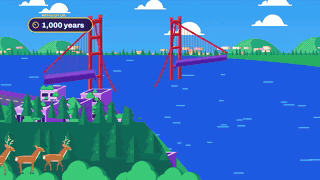</a> <a href="https://ultramotion.ai/templates/kurzgesagt-style-life-after-people/?lang=zh&utm_source=github&utm_medium=readme&utm_campaign=awesome-claude-video-styles"><b>【Kurzgesagt 风】人类消失以后</b></a> 如果人类明天消失，城市、港口、铁路和大桥会怎样：时间一路快进到一万年，每一帧都在变</td><td valign="top" width="33%"><a href="https://ultramotion.ai/templates/kurzgesagt-style-inside-the-body/?lang=zh&utm_source=github&utm_medium=readme&utm_campaign=awesome-claude-video-styles">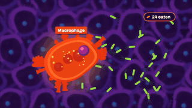</a> <a href="https://ultramotion.ai/templates/kurzgesagt-style-inside-the-body/?lang=zh&utm_source=github&utm_medium=readme&utm_campaign=awesome-claude-video-styles"><b>【Kurzgesagt 风】身体里发生了什么</b></a> 钻进皮肤底下讲一场看不见的仗：细菌、巨噬细胞、血管、中性粒细胞，一个个细胞都在动</td></tr>
<tr><td valign="top" width="33%"> <a href="https://ultramotion.ai/templates/kurzgesagt-style-space-elevator/?lang=zh&utm_source=github&utm_medium=readme&utm_campaign=awesome-claude-video-styles"><b>【Kurzgesagt 风】太空电梯怎么造</b></a> 一步步讲清一个巨构怎么造：火箭剖面、按比例的全貌、空间站、放缆、海上锚点、爬升舱，全部矢量部件在动</td><td valign="top" width="33%"> <a href="https://ultramotion.ai/templates/kurzgesagt-style-what-if/?lang=zh&utm_source=github&utm_medium=readme&utm_campaign=awesome-claude-video-styles"><b>【Kurzgesagt 风】假如</b></a> 一个"假如"在真实地方按真实比例一步步演出来：章节卡、紫色世界在变、刻度尺、旁白</td><td valign="top" width="33%"> <a href="https://ultramotion.ai/templates/kurzgesagt-style-size-comparison/?lang=zh&utm_source=github&utm_medium=readme&utm_campaign=awesome-claude-video-styles"><b>【Kurzgesagt 风】尺寸对比</b></a> 一组东西从小到大排开，镜头一次次往后拉，最后一个大到其余都成了小点；真实尺寸，配旁白</td></tr>
<tr><td valign="top" width="33%"> <a href="https://ultramotion.ai/templates/explain-a-number/?lang=zh&utm_source=github&utm_medium=readme&utm_campaign=awesome-claude-video-styles"><b>【扁平动画】一分钟讲清一个数字</b></a> 带旁白的科普：一个惊人的数到底有多大</td><td valign="top" width="33%"> <a href="https://ultramotion.ai/templates/chalkboard-lesson/?lang=zh&utm_source=github&utm_medium=readme&utm_campaign=awesome-claude-video-styles"><b>【粉笔手绘】黑板课</b></a> 课堂、讲清一个为什么</td><td valign="top" width="33%"> <a href="https://ultramotion.ai/templates/method-on-paper/?lang=zh&utm_source=github&utm_medium=readme&utm_campaign=awesome-claude-video-styles"><b>【手绘】纸上讲方法</b></a> 一个方法、读书笔记、几个步骤</td></tr>
<tr><td valign="top" width="33%"> <a href="https://ultramotion.ai/templates/word-captions/?lang=zh&utm_source=github&utm_medium=readme&utm_campaign=awesome-claude-video-styles"><b>【Hormozi 字幕】口播逐词字幕</b></a> 口播、采访、播客切片：念到哪个词亮哪个，关键词变色</td><td valign="top" width="33%"> <a href="https://ultramotion.ai/templates/ali-abdaal-style-talking-head/?lang=zh&utm_source=github&utm_medium=readme&utm_campaign=awesome-claude-video-styles"><b>【Ali Abdaal 式】口播图形</b></a> 把你的口播剪成效率类博主的样子：远近交替推镜，每个要点一张编号章节卡加手绘涂鸦，关键句粗体白字压底</td><td valign="top" width="33%"> <a href="https://ultramotion.ai/templates/talking-head-captions/?lang=zh&utm_source=github&utm_medium=readme&utm_campaign=awesome-claude-video-styles"><b>【韩综花字】口播字幕</b></a> 探店、知识口播、vlog，加在你自己的视频上</td></tr>
</table>

## 歌词和音乐

字跟着拍子走，唱的说唱的都行。

<table>
<tr><td valign="top" width="33%"> <a href="https://ultramotion.ai/templates/karaoke-lyric-video/?lang=zh&utm_source=github&utm_medium=readme&utm_campaign=awesome-claude-video-styles"><b>【Apple Music 唱歌模式】歌词视频</b></a> 给自己的歌做歌词视频，字随着唱一个个亮起</td><td valign="top" width="33%"> <a href="https://ultramotion.ai/templates/fluid-light-teaser/?lang=zh&utm_source=github&utm_medium=readme&utm_campaign=awesome-claude-video-styles"><b>【Spotify Canvas】单曲预告</b></a> 新歌、专辑上线前的短视频预告</td><td valign="top" width="33%"> <a href="https://ultramotion.ai/templates/rap-lyric-video/?lang=zh&utm_source=github&utm_medium=readme&utm_campaign=awesome-claude-video-styles"><b>【大字块】说唱歌词</b></a> 说唱片段：满屏大字，唱到哪亮到哪，押韵的词变色</td></tr>
<tr><td valign="top" width="33%"> <a href="https://ultramotion.ai/templates/karaoke-ktv/?lang=zh&utm_source=github&utm_medium=readme&utm_campaign=awesome-claude-video-styles"><b>【KTV】伴奏字幕</b></a> KTV 式双行歌词，从左往右变色，配伴奏</td><td valign="top" width="33%"> <a href="https://ultramotion.ai/templates/karaoke-ballpark/?lang=zh&utm_source=github&utm_medium=readme&utm_campaign=awesome-claude-video-styles"><b>【球场大屏】全场跟唱</b></a> 球场、演唱会、年会大屏上的全场跟唱</td><td valign="top" width="33%"> <a href="https://ultramotion.ai/templates/glitch-lyric-card/?lang=zh&utm_source=github&utm_medium=readme&utm_campaign=awesome-claude-video-styles"><b>【老电视故障】歌词卡</b></a> 单曲发布、歌词卡、乐队宣传</td></tr>
<tr><td valign="top" width="33%"> <a href="https://ultramotion.ai/templates/neon-single-cover/?lang=zh&utm_source=github&utm_medium=readme&utm_campaign=awesome-claude-video-styles"><b>【霓虹】单曲封面</b></a> 单曲、专辑、歌单的封面动图</td></tr>
</table>

## 招牌和海报

会亮起来的霓虹，会动的海报字。

<table>
<tr><td valign="top" width="33%"> <a href="https://ultramotion.ai/templates/neon-motel-sign/?lang=zh&utm_source=github&utm_medium=readme&utm_campaign=awesome-claude-video-styles"><b>【66 号公路】汽车旅馆霓虹</b></a> 汽车旅馆、路边餐厅、加油站</td><td valign="top" width="33%"> <a href="https://ultramotion.ai/templates/kinetic-event-poster/?lang=zh&utm_source=github&utm_medium=readme&utm_campaign=awesome-claude-video-styles"><b>【瑞士海报风】活动海报</b></a> 演出、市集、快闪、分享会</td><td valign="top" width="33%"> <a href="https://ultramotion.ai/templates/glitch-club-poster/?lang=zh&utm_source=github&utm_medium=readme&utm_campaign=awesome-claude-video-styles"><b>【故障风】电子音乐海报</b></a> 电子音乐、夜店、派对活动</td></tr>
<tr><td valign="top" width="33%"> <a href="https://ultramotion.ai/templates/neon-on-your-photo/?lang=zh&utm_source=github&utm_medium=readme&utm_campaign=awesome-claude-video-styles"><b>【霓虹】照片上的招牌</b></a> 用你自己门面的照片，招牌在上面通电亮起</td><td valign="top" width="33%"> <a href="https://ultramotion.ai/templates/countdown-poster/?lang=zh&utm_source=github&utm_medium=readme&utm_campaign=awesome-claude-video-styles"><b>【动感排版】倒计时</b></a> 跨年零点、演出开场、活动开门</td><td valign="top" width="33%"> <a href="https://ultramotion.ai/templates/pixel-cafe-menu/?lang=zh&utm_source=github&utm_medium=readme&utm_campaign=awesome-claude-video-styles"><b>【像素风】咖啡店菜单屏</b></a> 门店电视上循环播的菜单、新品海报</td></tr>
<tr><td valign="top" width="33%"> <a href="https://ultramotion.ai/templates/quote-poster/?lang=zh&utm_source=github&utm_medium=readme&utm_campaign=awesome-claude-video-styles"><b>【动感排版】金句海报</b></a> 一句话、书摘、演讲金句</td></tr>
</table>

## 会动的画

名画和水墨，动起来。

<table>
<tr><td valign="top" width="33%"> <a href="https://ultramotion.ai/templates/van-gogh/?lang=zh&utm_source=github&utm_medium=readme&utm_campaign=awesome-claude-video-styles"><b>【油画笔触】梵高</b></a> 艺术科普、名画讲解、展览宣传</td><td valign="top" width="33%"> <a href="https://ultramotion.ai/templates/leonardo/?lang=zh&utm_source=github&utm_medium=readme&utm_campaign=awesome-claude-video-styles"><b>【晕涂】达·芬奇</b></a> 名画讲解、展览宣传：一幅没有笔触的画，从空画板一笔笔晕出来</td><td valign="top" width="33%"> <a href="https://ultramotion.ai/templates/paper-marbling/?lang=zh&utm_source=github&utm_medium=readme&utm_campaign=awesome-claude-video-styles"><b>【湿拓画】课程预告</b></a> 手作课、工作室、展览的预告</td></tr>
<tr><td valign="top" width="33%"> <a href="https://ultramotion.ai/templates/monet/?lang=zh&utm_source=github&utm_medium=readme&utm_campaign=awesome-claude-video-styles"><b>【油画笔触】莫奈</b></a> 艺术科普、印象派、展览宣传</td><td valign="top" width="33%"> <a href="https://ultramotion.ai/templates/ink-your-picture/?lang=zh&utm_source=github&utm_medium=readme&utm_campaign=awesome-claude-video-styles"><b>【水墨】让一张画晕开</b></a> 把一张画或照片变成会动的水墨</td><td valign="top" width="33%"> <a href="https://ultramotion.ai/templates/ink-seasons/?lang=zh&utm_source=github&utm_medium=readme&utm_campaign=awesome-claude-video-styles"><b>【水墨】节气山水</b></a> 节气、春节、中秋这类节日祝福</td></tr>
</table>

## 祝福和纪念

生日、新年、婚礼请柬、一趟旅行。

<table>
<tr><td valign="top" width="33%"> <a href="https://ultramotion.ai/templates/spotify-wrapped-year-in-review/?lang=zh&utm_source=github&utm_medium=readme&utm_campaign=awesome-claude-video-styles"><b>【Spotify Wrapped】年度回顾</b></a> 把一个人的一年做成 Wrapped 式快拍：一屏一个数据，2025 Wrapped 的黑白欧普、红色年份和蓝色大数字</td><td valign="top" width="33%"> <a href="https://ultramotion.ai/templates/year-in-review/?lang=zh&utm_source=github&utm_medium=readme&utm_campaign=awesome-claude-video-styles"><b>【相册】年度回顾</b></a> 自己的一年：十二张照片、几个数字、一句话收尾</td><td valign="top" width="33%"> <a href="https://ultramotion.ai/templates/karaoke-birthday-song/?lang=zh&utm_source=github&utm_medium=readme&utm_campaign=awesome-claude-video-styles"><b>【毛笔字】生日祝福歌</b></a> 发到家庭群的生日贺卡，唱到哪一句写出哪一句，歌里唱出名字</td></tr>
<tr><td valign="top" width="33%"> <a href="https://ultramotion.ai/templates/paper-save-the-date/?lang=zh&utm_source=github&utm_medium=readme&utm_campaign=awesome-claude-video-styles"><b>【立体贺卡】婚礼请柬</b></a> 婚礼请柬、Save the Date、纪念日邀请</td><td valign="top" width="33%"> <a href="https://ultramotion.ai/templates/pixel-birthday-level-up/?lang=zh&utm_source=github&utm_medium=readme&utm_campaign=awesome-claude-video-styles"><b>【宝可梦升级】宠物生日卡</b></a> 用你自己的照片做生日、纪念日祝福，宠物和孩子都合适</td><td valign="top" width="33%"> <a href="https://ultramotion.ai/templates/new-year-particles/?lang=zh&utm_source=github&utm_medium=readme&utm_campaign=awesome-claude-video-styles"><b>【粒子光效】新年祝福</b></a> 跨年、新年祝福、年会开场</td></tr>
<tr><td valign="top" width="33%"> <a href="https://ultramotion.ai/templates/paper-cut-new-year/?lang=zh&utm_source=github&utm_medium=readme&utm_campaign=awesome-claude-video-styles"><b>【剪纸窗花】春节祝福</b></a> 春节发给家人和群里的祝福</td><td valign="top" width="33%"> <a href="https://ultramotion.ai/templates/pixel-route-map/?lang=zh&utm_source=github&utm_medium=readme&utm_campaign=awesome-claude-video-styles"><b>【马里奥地图】闯关讲路线</b></a> 旅行路线、行程，也能讲课程路线、入职流程</td></tr>
</table>

## 更多

网站上的其他模板。

<table>
<tr><td valign="top" width="33%"> <a href="https://ultramotion.ai/templates/neon-shop-sign/?lang=zh&utm_source=github&utm_medium=readme&utm_campaign=awesome-claude-video-styles"><b>【港风霓虹】店铺招牌</b></a> 小店夜里开门、开业、换新招牌</td><td valign="top" width="33%"> <a href="https://ultramotion.ai/templates/ktv-duet/?lang=zh&utm_source=github&utm_medium=readme&utm_campaign=awesome-claude-video-styles"><b>【KTV】男女对唱</b></a> 对唱、合唱：男声、女声、合唱各一种颜色，下一句提前出现</td><td valign="top" width="33%"> <a href="https://ultramotion.ai/templates/neon-rainy-window/?lang=zh&utm_source=github&utm_medium=readme&utm_campaign=awesome-claude-video-styles"><b>【霓虹】雨窗外的招牌</b></a> 深夜小店、城市夜景、情绪短片</td></tr>
<tr><td valign="top" width="33%"> <a href="https://ultramotion.ai/templates/neon-arrow-sign/?lang=zh&utm_source=github&utm_medium=readme&utm_campaign=awesome-claude-video-styles"><b>【复古霓虹】指路灯牌</b></a> 楼上小店、地下酒吧、藏在巷子里的店</td><td valign="top" width="33%"> <a href="https://ultramotion.ai/templates/ink-creatures/?lang=zh&utm_source=github&utm_medium=readme&utm_campaign=awesome-claude-video-styles"><b>【水墨】国画小品</b></a> 国风内容、文化科普、品牌片头</td></tr>
</table>

另见：[Awesome Claude 3D Videos](https://github.com/sunsiyuan/awesome-claude-3d-videos)——Claude 做的 500+ 个 3D 场景、世界和游戏，都链到原帖。

## 参与

用这些风格做了视频，或者知道一种大家都在模仿、这里还没有的风格？开个 issue 或 PR 附上链接。

## 许可

[CC BY 4.0](LICENSE)。不是我们做的样片都标了作者。
